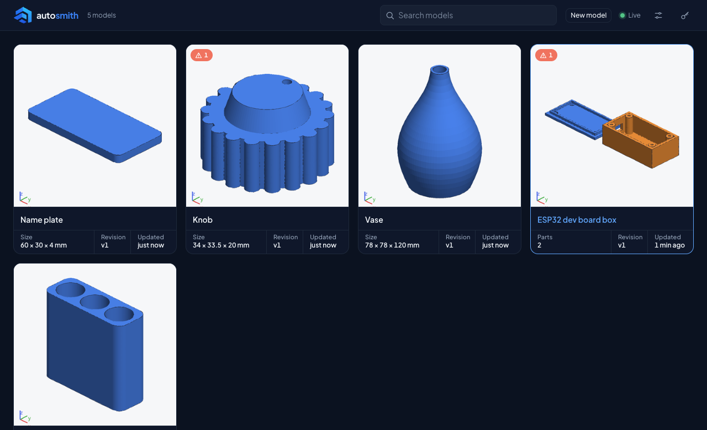
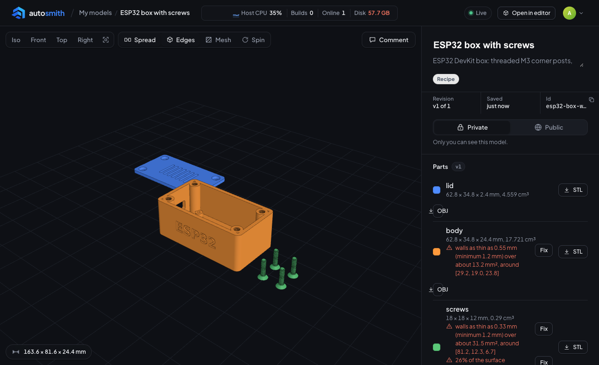
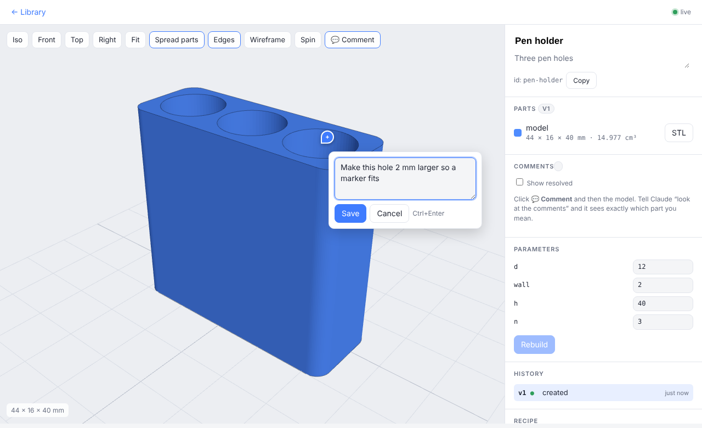
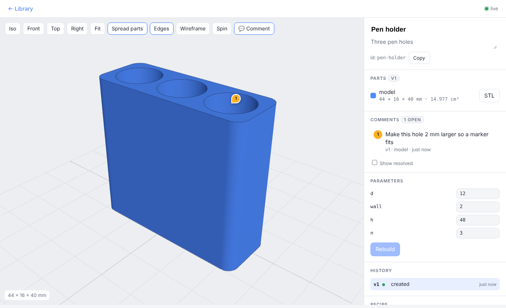
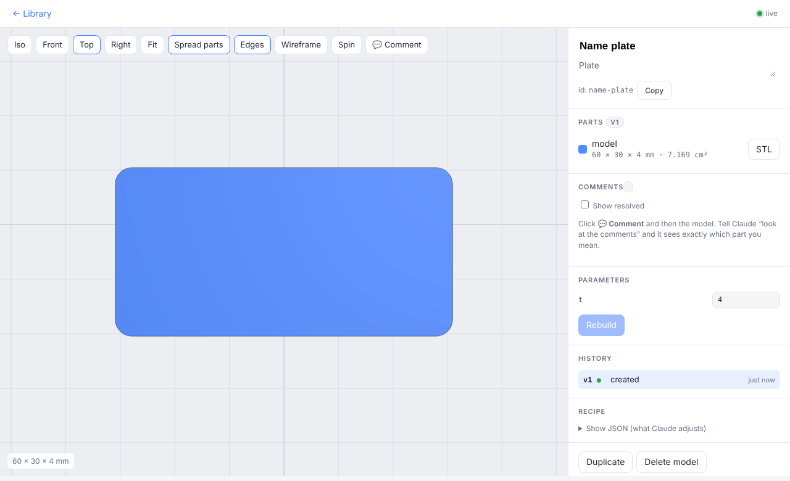
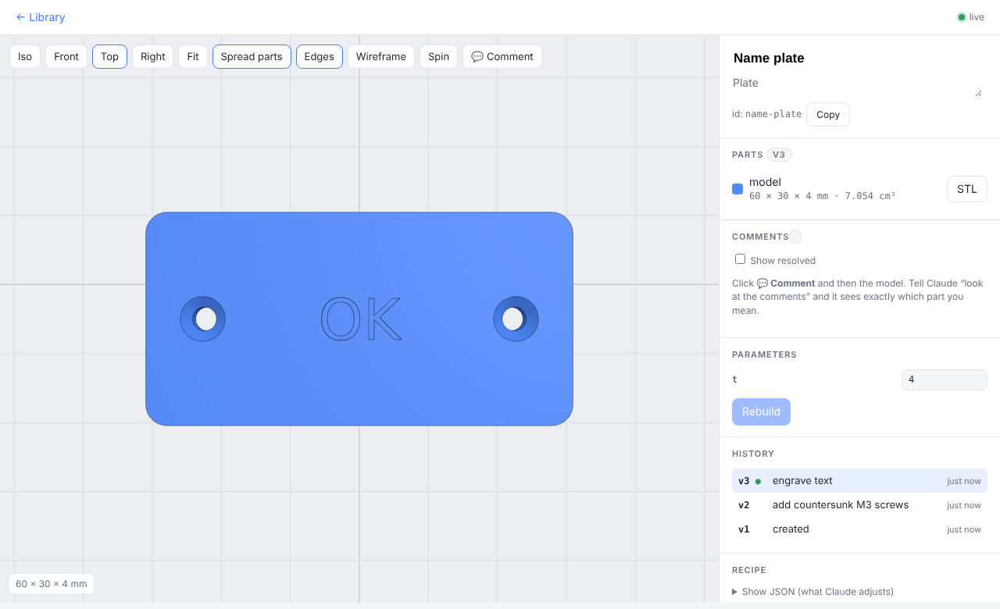

# autosmith.eu

*STL, made by AI.* (repo and service name: `stl-mcp`)

Self-hosted MCP server where Claude creates and iteratively adjusts 3D models for printing (mm),
with a web interface for viewing, rotating and browsing the models.

- **MCP** (streamable HTTP) at `/mcp`
- **Library** at `/`: all models with preview, search, live updates



- **3D view** at `/m/<id>`: rotate/zoom, show/hide parts, version history, edit parameters,
  download STL. The view updates **immediately** when Claude changes the model.



- **Comments**: click a point on the model and write what should change. Claude sees the
  point and which part of the recipe is located there.
- **Design system**: colours, type, icons and components are documented in
  [`docs/DESIGN.md`](docs/DESIGN.md) and shown live in the admin section at `/admin/design`.
- **Templates**: screw holes (M2–M5, countersunk/cylindrical, nut trap), heat inserts, screw bosses,
  snap hooks, hinges and text.

## The idea: models are recipes, not files

Each model is stored as a *recipe* (JSON) with version history. The STL files are built from the recipe.
This lets Claude make small, precise changes (`{"wall": 3}`) instead of redoing everything,
and you can always go back to an earlier version.

Typical workflow, with the 3D view open in the browser next to the chat:

1. *"Make a pen holder with three holes for 12 mm pens"* → Claude calls `create_model` and
   gives you the link to the 3D view.
2. Claude calls `render_model` to see the result itself and fix obvious mistakes.
3. *"Four holes, and a bit taller"* → `update_model(id, {"n": 4, "h": 50})` → the view updates and
   the history shows v2.
4. You can also change the parameters directly in the web UI. Claude sees the change the next time it reads
   the model with `get_model`.
5. Or point: click **💬 Comment**, click the hole and write *"2 mm larger"*. Then say
   *"look at the comments"*. Claude gets the point, the part and `near_nodes`, that is, which node in
   the recipe is located there (e.g. `/root/children/1`, a `screw_hole`). It changes the model
   and closes the comment with `update_model(..., resolves=["c1"])`, or answers with
   `reply_to_comment`.

## Commenting directly in the UI

Instead of describing *"the third hole, on the right side, near the top"* in chat, you point at it.

1. Open the model at `/m/<id>` and click **💬 Comment** (<kbd>Esc</kbd> leaves comment mode).
2. Click the spot on the model that you mean. A popup appears next to the point.
3. Write what should change and press **Save** (or <kbd>Ctrl</kbd>/<kbd>⌘</kbd>+<kbd>Enter</kbd>).



The comment shows up as a numbered pin on the model and in the **Comments** list in the side panel.
Click a comment in the list to centre the view on its pin. Each comment can be replied to, marked
resolved/reopened or deleted; tick **Show resolved** to see the closed ones.



### What Claude sees
Comments are stored with the model. `get_model` returns them with the exact point you clicked and
`near_nodes`, the recipe nodes closest to that point, so Claude knows which part of the recipe you mean
without guessing:

```json
{
  "id": "c1",
  "text": "Make this hole 2 mm larger so a marker fits",
  "version": 1,
  "part": "model",
  "status": "open",
  "point": [32.8, 13.07, 37.38],
  "normal": [0.514, -0.858, 0.0],
  "near_nodes": [
    {"pointer": "/root/children/1", "shape": "cylinder", "distance_mm": 0.0},
    {"pointer": "/root/children/0", "shape": "box", "distance_mm": 0.0}
  ]
}
```

### Example round trip
1. You click the hole and write *"Make this hole 2 mm larger so a marker fits"*.
2. You tell Claude *"look at the comments"* (or let [`tools/stl_watch.py`](#having-claude-react-to-comments-immediately)
   do it automatically).
3. Claude reads `near_nodes`, sees that `/root/children/1` is the pen hole cylinder driven by the variable `d`,
   and calls:
   ```jsonc
   update_model("pen-holder", {"changes": {"d": 14}, "resolves": ["c1"]})
   ```
4. The 3D view reloads as v2 and the comment is marked resolved (hidden unless **Show resolved** is ticked).
   If Claude needs more information it calls `reply_to_comment` instead, and the answer appears under your comment.

Comments belong to the version they were made on (shown as `v1 · model` in the list), so you can still tell what
a comment referred to after the model has changed.

### Having Claude react to comments immediately
Instead of saying *"look at the comments"*, run `tools/stl_watch.py watch` as a background monitor in a
Claude Code session. It follows the server's `/api/events` stream and prints one
`NEW_COMMENT model=<id> open=<n> url=...` line for each new open comment, which wakes Claude, who
reads it (`tools/stl_watch.py comments`) and answers it with `update_model(..., resolves=[...])`.
Claude can not be woken by the server on its own (connecting claude.ai does not start this), so this
watcher is what makes the reaction instant.
```
export STL_MCP_URL=https://your-server          # default: https://stl.tilly.se
python3 tools/stl_watch.py login                # once: sign in in the browser, like connecting claude.ai
python3 tools/stl_watch.py watch
```
`login` runs the server's normal OAuth consent flow (the same one claude.ai uses): it opens your
browser, you sign in and press **Allow**, and the watcher then acts as that account and sees exactly
its models and comments. The refresh token is kept in `~/.config/stl-watch/oauth.json` (mode 0600)
and renewed automatically. If it is revoked (the account's *Connected apps* list, or "log out
everywhere") or unused for 90 days, `watch` exits with `WATCH_STOPPED`; run `login` again.
Use `STL_MCP_TOKEN` (or the keychain item `stl-mcp-token`) to authenticate with the server's
`MCP_TOKEN` instead; it overrides `login` and sees everything.

The script needs only the standard library and never prints a token. It runs while that session
is open; comments made while nothing is watching simply wait.

## Running
```
cp .env.example .env     # fill in MCP_TOKEN, POSTGRES_PASSWORD and PUBLIC_URL
docker compose up -d --build
```
The compose file starts Postgres next to the server; database migrations run at startup.
Without Docker: `pip install -r requirements.txt && DATABASE_URL=postgresql://... MCP_TOKEN=... python server.py`

The container only listens on `127.0.0.1:8765`. Set `BIND=0.0.0.0` to expose the port directly,
or set `DOMAIN` and run `docker compose --profile caddy up -d` for automatic HTTPS.

**Deploy:** merging to `main` builds the image on GitHub and deploys it to stl.tilly.se; see
[`deploy/README.md`](deploy/README.md).

Open `http://localhost:8765/` and log in with the token, or go to `/?token=<token>`, which
sets a session cookie for the admin account (`ADMIN_EMAILS`, the first entry). Then add a passkey (the banner in the library, or 🔑 in the header):
from then on, logging in is one tap with Face ID, Touch ID or your password manager. Passkeys
are bound to the host name in `PUBLIC_URL`.

## Tests
```
pip install -r requirements.txt -r requirements-dev.txt
docker compose --profile test up -d postgres-test   # throwaway Postgres on 127.0.0.1:55432
python -m pytest
```
Each run uses its own schema in that database (`TEST_DATABASE_URL` overrides the address).
`test_client.py` is a manual smoke script against a running server, not part of the suite.

## Connecting to Claude
- Claude Desktop/Code: `claude mcp add --transport http stl https://<your-url>/mcp --header "Authorization: Bearer <token>"`
- claude.ai and the Claude apps: see below. No token is needed, you approve the connection with
  your passkey.

### Connecting claude.ai, step by step
Once, about a minute. The connector then also works in the Claude apps on your phone and desktop.

1. **Get a passkey (recommended).** Open the library (`https://<your-url>/`, for this deployment
   `https://stl.tilly.se/`), log in with the token once and click **Add passkey** in the banner
   (or under 🔑 in the header). Without a passkey you can still log in with the token in step 5.
2. In claude.ai, open **Settings → Connectors** and click **Add custom connector**.
3. Name: `autosmith`. URL: `https://<your-url>/mcp` (here: `https://stl.tilly.se/mcp`).
   Leave the advanced settings (OAuth client id/secret) empty. Click **Add**.
4. Click **Connect** next to the new connector. A page from your server opens.
5. If you are not logged in there, click **Log in with passkey** (or use the token).
6. The page asks *Connect Claude?* and says where you will be sent back to. Check that it is
   `https://claude.ai`, then click **Allow**. You are sent back and the connector shows as
   connected.
7. In a chat, turn the connector on in the tools menu and ask, for example, *"Make a box
   80×50×25 mm with a lid"*. Claude answers with a link to the model in the library.

**If something goes wrong**
- *"The request has expired"*: the approval page is valid for 10 minutes. Click Connect again.
- Connect fails before any page opens: `PUBLIC_URL` must be the exact https address (here
  `https://stl.tilly.se`), and the server log must not say `OAuth disabled`.
- **Disconnecting:** 🔑 → Connected apps → **Disconnect** stops the app's access at once (it must
  be approved again to reconnect). Rotating `MCP_TOKEN` logs browsers out but does *not*
  disconnect apps, so use Disconnect for that.

The server is its own OAuth authorization server (dynamic client registration, PKCE, consent
page). It requires `PUBLIC_URL` on https (or localhost); `OAUTH=0` turns it off.

## MCP tools
| tool | |
|---|---|
| `create_model` | new model from a CSG spec (shapes, boolean operations, transforms, variables) |
| `create_enclosure` | box + lid with corner screws, standoffs, cutouts and lid holes |
| `create_from_script` | arbitrary trimesh Python (requires `ALLOW_SCRIPT=1`, runs code on the server!) |
| `update_model` | change variables/parameters or any value via JSON pointer → new version |
| `get_model` | the recipe, dimensions, history and open comments (with `near_nodes`) |
| `reply_to_comment` | reply to a comment, optionally marking it resolved |
| `render_model` | PNG image (iso/front/top/right) so Claude can inspect the model visually |
| `list_models`, `revert_model`, `duplicate_model`, `delete_model` | |
| `whoami` | the account the connection is signed in as |
| `import_file` | imports STL/OBJ/GLB/PLY/OFF via `url` or `data_base64` (zip with obj+mtl is unpacked) |
| `file_info` | dimensions, bounds, volume, number of loose parts |
| `check_print` | re-run the print check on a library model or a standalone file with the current settings |
| `modify_file` | scale, rotate, mirror, place, add/subtract shapes (e.g. screw holes), repair mesh, simplify |
| `split_file` | splits a file into its loose parts |
| `export_obj` | merges several STLs (including library ones, `<model_id>/v3/lid.stl`) into one colored OBJ (+ .mtl and .zip) |
| `list_files`, `delete_file` | standalone files (import/export) |

### The CSG spec in brief
```json
{
  "vars": {"d": 12, "wall": 2, "h": 40, "n": 3},
  "root": {"op": "difference", "children": [
    {"shape": "box", "size": ["=n*(d+wall)+wall", "=d+2*wall", "=h"], "radius": 3, "round": "vertical"},
    {"shape": "cylinder", "d": "=d", "h": "=h", "translate": ["=wall+d/2", "=wall+d/2", "=wall"],
     "array": {"count": ["=n", 1, 1], "step": ["=d+wall", 0, 0]}}
  ]}
}
```
- Shapes: `box` (with `radius`), `cylinder`, `cone`, `sphere`, `tube`, `torus`, `wedge`,
  `extrude` (polygon/circle/rectangle profile, `twist`, `scale_top`) and `revolve`
- Templates: `screw_hole`, `heat_insert`, `nut_trap` (cutting: the surface is at z=0, going downward),
  `boss`, `snap_hook`, `hinge` (print-in-place or with a separate pin) and `text`
  (DejaVu Sans, raised or engraved). Dimensions for M2–M5 are in `templates.py`.
- Operations: `union`, `difference`, `intersection`, `hull`, `minkowski`
- All nodes: `translate`, `rotate` (degrees), `scale`, `mirror`, `array`, `polar`, `hidden`
- Multiple parts (one STL per part): `{"parts": {"body": {...}, "lid": {...}}}`
- Strings starting with `=` are expressions: `"=w/2+wall"`, `"=max(a,b)"`, `"=cos(30)"`
  (safe evaluation, no code is run)

The full reference is in `csg.py` (`SPEC_HELP`), and Claude gets it in the tool description.

### Adjusting with `update_model`
```jsonc
{"changes": {"wall": 3}}                          // CSG: variable; box: parameter
{"changes": {"/root/children/1/d": 8}}            // any value via JSON pointer
{"changes": {"/root/children/-": {"shape": ...}}} // add a node
{"remove": ["/root/children/2"]}                  // remove a node
{"params": {...}}                                 // replace the whole recipe
{"changes": {...}, "resolves": ["c1"]}            // ...and mark comment c1 as resolved
```

Example with templates, a plate with countersunk M3 holes and engraved text:
```json
{"vars": {"t": 4}, "root": {"op": "difference", "children": [
  {"shape": "box", "size": [60, 30, "=t"], "radius": 3, "round": "vertical"},
  {"shape": "screw_hole", "size": "M3", "head": "countersunk", "h": "=t",
   "translate": [8, 15, "=t"], "array": {"count": [2, 1, 1], "step": [44, 0, 0]}},
  {"shape": "text", "text": "OK", "size": 8, "h": 1, "halign": "center", "valign": "center",
   "translate": [30, 15, "=t-0.6"]}
]}}
```

### Before and after: adding screws and text
Start from a plain plate (v1) and let Claude add two countersunk M3 screw holes (v2) and engraved text (v3).
Every step is a small `update_model` call and shows up in the history in the side panel:

```jsonc
update_model("name-plate", {"changes": {"/root/children/-": {"shape": "screw_hole", "size": "M3",
  "head": "countersunk", "h": "=t", "translate": [8, 15, "=t"],
  "array": {"count": [2, 1, 1], "step": [44, 0, 0]}}}})                       // v2
update_model("name-plate", {"changes": {"/root/children/-": {"shape": "text", "text": "OK", "size": 8,
  "h": 1, "halign": "center", "valign": "center", "translate": [30, 15, "=t-0.6"]}}})  // v3
```

| Before (v1) | After (v3) |
|---|---|
|  |  |

## Tinkercad
Tinkercad has no public API, so exchange happens via files:

- **To Tinkercad:** download the `.stl` (one part) or the `export_obj` result (several colored parts) and
  choose *Import* in Tinkercad. Files larger than `TINKERCAD_MAX_MB` (default 25) automatically get a
  simplified copy `<name>_tinkercad.stl`.
- **From Tinkercad:** *Export* → `.STL` or `.OBJ` (zip). Upload the file to the server:
  ```
  curl -T model.stl -H "Authorization: Bearer <token>" https://<your-url>/upload/model.stl
  ```
  or let Claude fetch it with `import_file` (url). Then keep building with `modify_file`.
  `import_file` only fetches from public addresses unless `ALLOW_PRIVATE_URLS=1`.

Imported and modified files are standalone files, private to the user who made them
(`STL_DIR/files/<user id>/`, served at `/f/<user id>/<name>`). They do not show up in the web library.

## Print check and admin settings
Every build runs a fast, approximate print check per part. Problems are **warnings only** (nothing
is blocked): they are returned to Claude as `print_warnings`, shown under each part in the 3D view
and as a badge in the library.

| check | warns when |
|---|---|
| watertight | open edges/holes, or inverted normals (critical) |
| disconnected shells | one part consists of several unconnected pieces |
| thin walls | material thinner than the minimum wall thickness over a noticeable area |
| overhangs | too large a share of the surface overhangs more than the maximum angle |
| build volume | the part does not fit the printer bed |

Thresholds have sensible defaults (`printcheck.py`, `SCHEMA`) and can be changed at `/admin`
(token required, even with `UI_PUBLIC=1`): per-check switches, minimum wall (1.2 mm), overhang angle
(45°) and share (10 %), and the build volume (220 × 220 × 250 mm). Overrides are stored in
`STL_DIR/settings.json`. New settings apply to new builds; **Re-check all models** on the admin page
(or `POST /api/recheck`) refreshes existing models without creating versions.
The thin-wall and overhang checks are sampling-based estimates, not a slicer.

## Storage
Users, sessions, passkeys and tokens live in Postgres (`DATABASE_URL`, schema in `migrations/`);
back it up with `docker compose exec postgres pg_dump -U stl stl > backup.sql`. An `auth.json` from
before users existed is imported into the admin account at startup and renamed `auth.json.imported`.

Every model belongs to a user. Its recipe, version history and comments are in Postgres (table
`models`); the built files are in `STL_DIR/models/<id>/v<N>/<part>.stl`. The 50 most recent versions
keep their files. Older versions can be recreated with `revert_model`. Models and standalone files
from before users existed (`model.json`, files directly in `STL_DIR`) become the admin's at startup.

Users only reach their own models and files; someone else's look exactly like ones that do not
exist (404). Admins reach everything.

## Accounts and signup
With `SIGNUP=1` anyone can create an account on the login page: a name and a passkey, nothing
else. Each account gets its own private library and standalone files; admins (`ADMIN_EMAILS`,
or `MCP_TOKEN`) see everything and the `/admin` pages. New users see a getting-started checklist,
and the account dialog (🔑) shows how to connect claude.ai, ChatGPT or Claude Code, with personal
tokens for clients that send a header.

- **Bots:** set `TURNSTILE_SITE_KEY` and `TURNSTILE_SECRET` (Cloudflare Turnstile, free) and keep
  the per-IP limit (`SIGNUPS_PER_HOUR`, default 5). Behind your own proxy set `TRUSTED_PROXY=1` so
  the limit sees the real client address.
- **Limits:** `MAX_MODELS_PER_USER` (100) and `MAX_DISK_MB_PER_USER` (500) apply to non-admins;
  Claude gets a clear error when one is reached. Script models are admin-only.
- **Leaving:** users delete their account and all its data from the account dialog. `/privacy`
  says what is stored.
- **Admin → Users** (`/admin/users`) lists every account with its models, storage and ways in, and
  can make admins, disable, log out everywhere or delete.

`SIGNUP=1` requires `MCP_TOKEN`; without it every visitor would be the admin.

### Sign in with Google, GitHub or Apple
Each provider appears on the login page once its settings are present (see `.env.example`). Register
`https://<your-domain>/auth/sso/<provider>/callback` as the redirect URI with the provider:

- **Google:** Google Cloud console → APIs & Services → Credentials → OAuth client ID (web
  application). Scopes `openid email profile`; publish the consent screen for public use.
- **GitHub:** Settings → Developer settings → OAuth Apps → New OAuth App.
- **Apple:** needs an Apple Developer Program membership. Create an App ID with *Sign in with
  Apple*, a Services ID (that is `APPLE_CLIENT_ID`) with your domain and the redirect URI, and a
  key with *Sign in with Apple* (`APPLE_KEY_ID`, and the downloaded `.p8` as `APPLE_PRIVATE_KEY`).

How a sign-in finds its account: an identity that is already linked logs in to its account; else a
**verified** email equal to an account's email links to that account; else a new account is
created (only with `SIGNUP=1`, within the per-IP limit). Emails are only ever taken from verified
sign-ins or `ADMIN_EMAILS`, never typed in, so nobody can claim someone else's address in advance.
A verified email in `ADMIN_EMAILS` makes the account an admin. In the account dialog users link
or unlink providers; the last way to log in cannot be removed.

## Security
Always set `MCP_TOKEN` and put the server behind HTTPS. The web interface requires a login
(passkey or token, kept as a signed session cookie for 90 days) unless `UI_PUBLIC=1`, which makes it readable by everyone while changes still require a token.
`FILES_PUBLIC=1` only makes the STL links clickable without a token (model ids are guessable); for
anonymous visitors, `UI_PUBLIC` and `FILES_PUBLIC` cover the admin's library only. Keep
`ALLOW_SCRIPT` off if the server is reachable from outside. `/upload/*` always requires a token when
`MCP_TOKEN` is set. The CSG spec is safe to let Claude write.

Every login belongs to a user. `MCP_TOKEN` logs in as the bootstrap admin; without it set, every
request runs as that admin (local single-user mode). Sessions are random ids stored server side
for 90 days, so logging out or disabling a user takes effect at once. OAuth access tokens live
24 h and refresh tokens 90 days (rotated on every use). Sessions and tokens are stored only as
sha256 hashes, next to the passkeys' public keys, in Postgres.
Client registration is open (as MCP requires), but nothing gets a token without your approval
on the consent page, which shows where the app will be sent back to.

three.js (MIT) is shipped locally from `web/vendor/three`, so the interface needs no CDN.
The DejaVu Sans font (free license, see `fonts/LICENSE`) is used for the text template.
